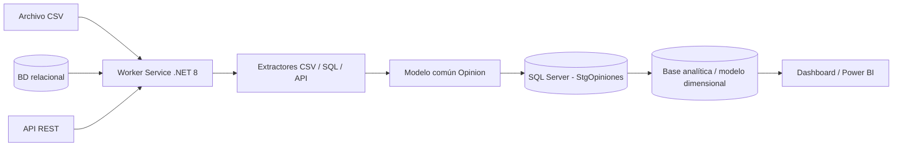
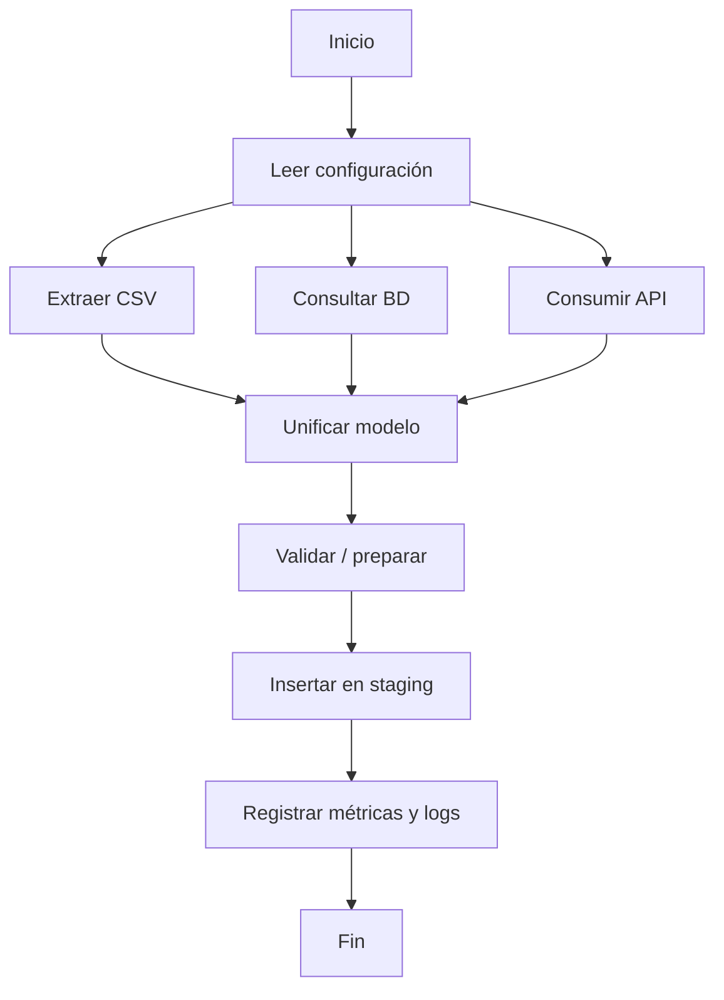

# Sistema de Análisis de Opiniones de Clientes – ETL .NET 8

Asignatura: Electiva 1 – 2026-C-3 | Docente: Francis Ramírez

Proyecto académico de extracción de datos (E de ETL) mediante Worker Service.

## Requisitos
- .NET 8 SDK
- SQL Server (para staging y, opcionalmente, fuente relacional)
- Conexión a Internet para la API de ejemplo

## Ejecutar
1. Ejecute `sql/staging.sql` en SQL Server.
2. Ajuste `appsettings.json` con las cadenas de conexión de origen y staging.
3. No suba credenciales reales a GitHub. Use User Secrets o variables de entorno en ambientes reales.
4. Desde esta carpeta ejecute:
   ```bash
   dotnet restore
   dotnet run
   ```

La fuente CSV de ejemplo está en `Data/encuestas.csv`. La API de ejemplo utiliza JSONPlaceholder; se transforma cada comentario a un registro de opinión. Para una API real, cambie `ETL:ApiUrl` y adapte `ApiComment` al contrato JSON real.

## Arquitectura


## Flujo


## Limitación académica
Esta entrega implementa la extracción y persistencia inicial en staging, que es el alcance de la práctica. La transformación avanzada, el modelo dimensional definitivo y el dashboard se plantean como etapas posteriores.
